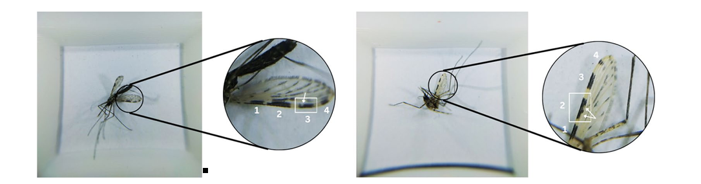
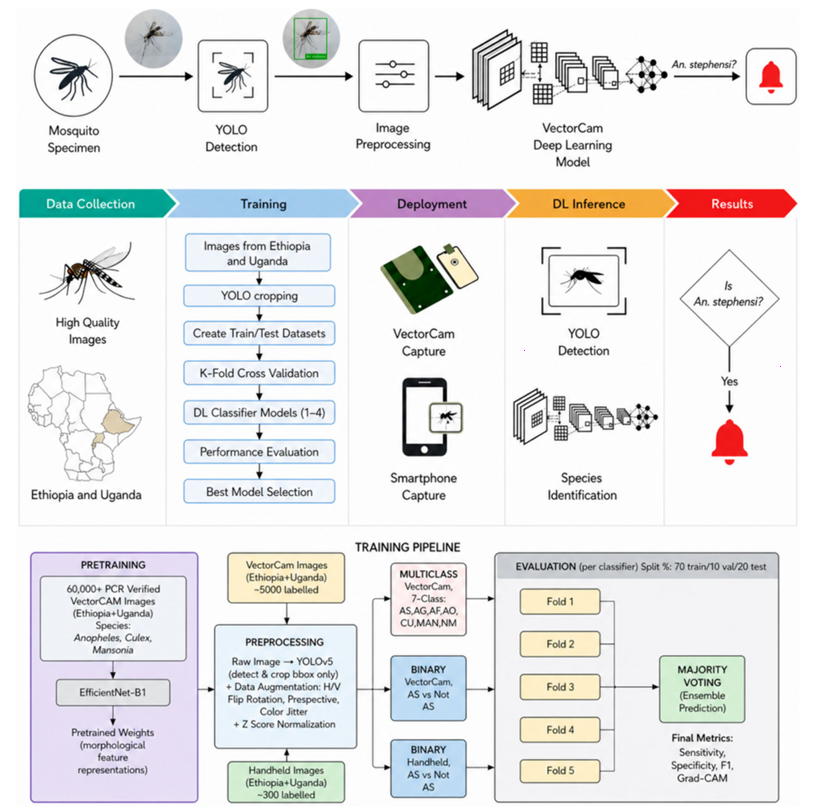
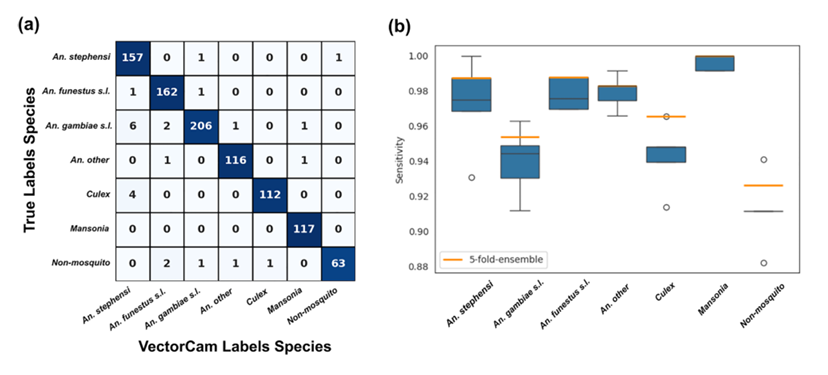
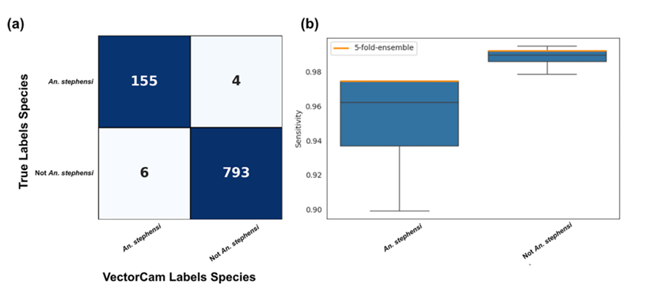
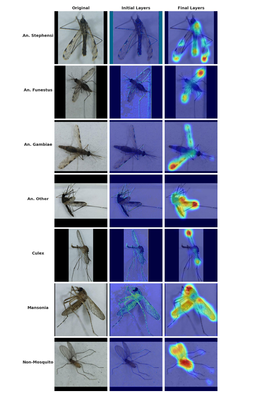

 🦟 Deep Learning for Morphological Identification of *Anopheles stephensi*

[]()
[]()
[]()

 📖 Study Overview

The invasion of the malaria vector *Anopheles stephensi* into sub-Saharan Africa poses a critical threat, particularly in urban settings. Because *An. stephensi* shares physical traits with native African mosquitoes (like *An. gambiae s.l.*), field identification is incredibly difficult and requires specialist training or expensive molecular testing.

This project developed and validated three deep learning Convolutional Neural Network (CNN) classifiers using the EfficientNet-B1 architecture to automate species identification from photographic images. 

Key Achievements:
*   🎯 VectorCam Multiclass Classifier: Achieved an *An. stephensi* sensitivity of 98.74% and overall accuracy of 96.02% across seven species classes.
*   🎯 VectorCam Binary Classifier: Achieved an *An. stephensi* sensitivity of 97.48% and a specificity of 99.25%, making it highly suitable for operational field surveillance.
*   📱 Smartphone Binary Classifier: Using images from standard smartphones with clip-on macro lenses, it achieved a sensitivity of 91.09% and specificity of 84.40%.
*   🧠 Explainable AI (Grad-CAM): Confirmed that the models are making decisions based on biologically meaningful features (wing venation and leg morphology), just as a trained entomologist would.


 📂 Repository Structure
      ``text
      Anopheles_DeepLearning_Project/
      │
      ├── 📁 Published_Papers/
      │   └── 📄 Deep_Learning_Anopheles_stephensi_Identification.pdf
      │
      ├── 📁 Figures/
      │   ├── 🖼️ Fig_1_Wing_Venation_Comparison.png
      │   ├── 🖼️ Fig_2_VectorCam_Device.png
      │   ├── 🖼️ Fig_3_System_Pipeline.png
      │   ├── 🖼️ Fig_4_VectorCam_Multiclass.png
      │   ├── 🖼️ Fig_5_VectorCam_Binary.png
      │   ├── 🖼️ Fig_6_Handheld_Binary.png
      │   ├── 🖼️ Fig_7_Grad_CAM.png
      │   └── 🖼️ Fig_8_UMAP.png
      │
      └── 📝 README.md
      ```


 📊 Key Visualizations

*Click the dropdown menus below to expand and view the pipeline and model performance.*

<br>

<details>
<summary><b>📸 Figure 1 & 2: The Challenge and The Solution</b></summary>
<br>
<p align="justify">
<i><b>Fig 1 (Left):</b> Comparative wing venation patterns of Anopheles gambiae and Anopheles stephensi. Notice the pale spot interruptions used for identification.<br>
<b>Fig 2 (Right):</b> The VectorCam field imaging device in operation, providing a standardized optical setup and controlled illumination for field use.</i>
</p>

*(Placeholder: Insert the combined image or side-by-side figures here)*
<!--  -->


</details>

<br>

<details>
<summary><b>⚙️ Figure 3: System Pipeline</b></summary>
<br>
<p align="justify">
<i>A schematic of the detection system. Specimens are captured via VectorCam or smartphone. YOLOv5 isolates the specimen, and the EfficientNet-B1 model classifies the species. The bottom panel shows the training pipeline using 5-fold cross-validation.</i>
</p>

*(Placeholder: Insert Fig_3_System_Pipeline.png here)*
<!--  -->


</details>

<br>

<details>
<summary><b>📈 Figure 4: VectorCam Multiclass Performance</b></summary>
<br>
<p align="justify">
<i>Ensemble performance of the multiclass classifier. The confusion matrix shows high accuracy across all seven classes, with a 98.74% sensitivity for An. stephensi.</i>
</p>

*(Placeholder: Insert Fig_4_VectorCam_Multiclass.png here)*
<!--  -->


</details>

<br>

<details>
<summary><b>🎯 Figure 5: VectorCam Binary Performance</b></summary>
<br>
<p align="justify">
<i>Performance of the binary classifier (An. stephensi vs. not An. stephensi). This model achieved a specificity of 99.25%, meaning false positive alerts are incredibly rare.</i>
</p>

*(Placeholder: Insert Fig_5_VectorCam_Binary.png here)*
<!--  -->


</details>

<br>

<details>
<summary><b>🧠 Figure 7: Grad-CAM Interpretability</b></summary>
<br>
<p align="justify">
<i>Gradient-weighted Class Activation Mapping (Grad-CAM) visualizations. Warmer regions indicate where the model is "looking." The final layers show intense focus on the wings and legs, proving the AI learned the correct entomological features.</i>
</p>

*(Placeholder: Insert Fig_7_Grad_CAM.png here)*
<!--  -->


</details>

 👥 Authors & Affiliations

Lead Authors: 
*   Parthvi Mehta (Johns Hopkins University)
*   Aravind Sunil Kumar (Johns Hopkins University)
*   Atul Zacharias (Johns Hopkins University)

Co-Authors:
*   Aryaman Shodhan, Deming Li, Sunny M. Patel, Marina Rincon Torroella, Joanne M. Cunningham
*   Diane Lovin, Biniam Lukas Chbute, Deneke Zewdu Gebremichael *(Jimma University)*
*   Rama Chellappa, Delenasaw Yewhalaw, Jane M. Carlton, Neil F. Lobo, Soumyadipta Acharya


 📜 Citation

If you use the data, figures, or methodology from this repository, please cite the publication:
> *Mehta P, Kumar AS, Zacharias A, Shodhan A, Li D, Patel SM, et al. Deep learning convolutional neural networks for morphological identification of field-caught Anopheles stephensi in Ethiopia, using smartphone images of specimens. [Journal Name]. 2026.*
